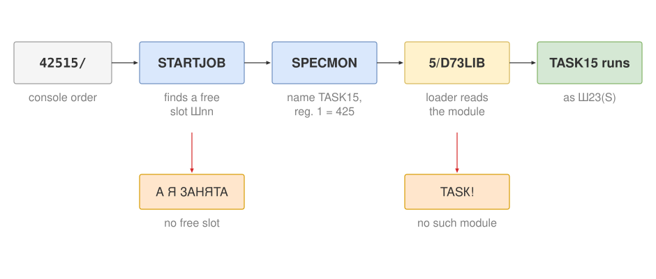
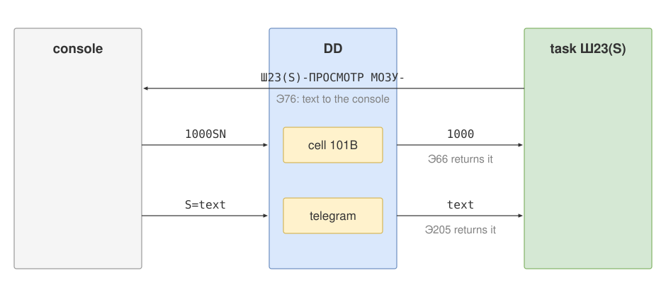

# Service Tasks of OS Dubna

> Written for this repository from the sources, November 2026. Tasks 27, 42, 60 and 65 were
> also run in SIMH; for the others, all texts and behaviour come from reading the code.
> Points the code does not settle are marked *(unclear)*.

A **service task** (*служебная задача*) is a small program that the operator
starts from the console.  Service Tasks are an extension of the basic
operator commands built into the dispatcher.  These tasks can be a site
specific and extend the capabilities of tools for operators and system
engineers without recompiling Dispatcher.
Tasks formats tapes, lists queues, tests devices, prints logs and the like.
The tasks are modules `TASK11` … `TASK76` of the task library **5/D73LIB**.
The `newbsz` job in

[tra-libs.dub](../BUILD/tra-libs.dub) builds that library from
[besmtask/task47.ts2](../besmtask/task47.ts2) (Madlen) and
[besmtask/task11.ts1](../besmtask/task11.ts1) (mostly Fortran).

All numbers here are octal, as on the console. The console texts below are written in
Cyrillic; the sources spell them with Latin lookalikes.

## Starting a task



- **`NN/`** starts task `NN`
  ([macro67.dd1:7007](../besmdisp/macro67.dd1#L7007)). Any digits typed before the
  number are its **parameter**. The dispatcher takes the whole number, up to 5 digits:
  the low two digits pick the task, and the rest goes to the task in index register 1.
  So `42515/` starts TASK15 with register 1 = 425, and `160/` starts TASK60 with 1. Many
  tasks treat 425 as a key for a dangerous mode.
- **`STARTJOB`** ([18197](../besmdisp/macro67.dd1#L18197)) gives the task a free service
  slot Ш. If none is free, it answers **`А Я ЗАНЯТА`** and nothing is started.
- **`SPECMON`** ([dubna.dd:18898](../dub_besm/dubna.dd#L18898)) loads the task.
  - It forms the module name `TASKnn` from the number, mounts the library tape
    (`D73LIB`, reel 5) and calls the loader.
  - If the module is not there, it answers **`ТАSК!`**. This is what `64/` gives.
  - It also stores the console that gave the order in cell 1067B (`MN*TL`), so the task's
    replies go back to that console.
- **Built-in programs.** Numbers below 20 in DD's own table
  ([18722](../besmdisp/macro67.dd1#L18722)) are programs inside DD, not library modules:
  - 10, the planner;
  - 13, СЛУГА;
  - 15, DISPINIT;
  - and a few others.
- **Library offset, `ddd77/`.** Number 77 is not a task. `ddd77/` sets the zone offset of
  the library on its tape. `77777/` asks for another library tape name (`L:ИМЯ БСЗ?`)
  ([19026](../dub_besm/dubna.dd#L19026)).
- **Tasks with their own orders.**
  - Some tasks are also started by special orders, which pass their own parameters
    ([Dubna_Commands.md](Dubna_Commands.md)):
    - `Р`: 11
    - `ПВ`: 74
    - `I`: 70
    - `DF`: 61
    - `МР`, `ИМР`: 62
    - `PANNO`: 47
    - `text/`: 75
  - At boot, DD itself starts 11 - ВЫВОД (the spooler) and 10 - ПЛАНИРОВЩИК (the planner).

## Talking to a task



- **Header.** A task introduces itself with a line that starts with its slot and letter,
  `Ш23(S)`. The letter is ISO code 0100 + slot number: Ш21 is `Q`, Ш22 `R`, Ш23 `S`.
- **Short answer.** The operator types the text, then the letter, then `N`: `1000SN`
  answers task S with `1000`.
  - The dispatcher stores the text in cell 101B, and the task picks it up with extracode
    Э66 (`FUN 66B`). Only about 6 characters fit.
  - `.N` (with the task's letter in place of `.`) is the empty answer. Many tasks take it
    as "yes" or "finish".
- **Whole line.** A few tasks read a whole line with Э205 instead (15, 16, 34). They prompt
  `S=`, and the operator types `S=text`.
- **Kill.** `NN.` kills the task on slot Ш`NN`.
- **Output.** Most tasks print short replies on the console and long listings on the
  printer through the spooler.
- **Key words.** Several tasks guard dangerous work behind a key, such as register
  1 = 425, ТР3 low bits = 71717, or ТР3 bits 48–43 equal to the device number. Without
  the key they refuse with a "warning" remark: `РУКИ ПРОЧЬ!`, `ЭТО БЕЗНРАВСТВЕННО !`,
  `НЕ ПОЛОЖЕНО - НЕ ЛЕЗЬ!`.

## Summary

"Stub" means the task is replaced by an empty module in `tra-libs.dub`, so here it ends at
once; see [Stubbed tasks](#stubbed-tasks).

| Task | Name | Purpose | Here |
|---|---|---|---|
| [11](#11--вывод-print-spooler) | ВЫВОД | Print spooler: prints and punches the output file | runs at boot |
| [15](#15--дай-пк-punch-cards-from-the-console) | ДАЙ П/К | Punch cards from text typed on the console | |
| [16](#16--обмен-текстами-ес-tape--besm-6-file) | ОБМЕН ТЕКСТАМИ | Copy text between an ЕС tape and a BESM-6 file | |
| [17](#17--листинг-dump-listings-to-an-ес-tape) | ЛИСТИНГ | Dump listings from the output file to an ЕС tape | |
| [20](#20--уввк-пи-copy-a-card-deck) | УВВК-ПИ | Read a card deck and punch N copies | |
| [21](#21--тест-ацпу-printer-test) | ТЕСТ АЦПУ | Printer test | |
| [22](#22--тест-пи--вв-card-punch-and-reader-test) | ТЕСТ ПИ / ВВ | Card punch and reader test | |
| [23](#23--тест-пл-80--fs1501-paper-tape-test) | ТЕСТ ПЛ-80 / FS1501 | Paper tape punch or reader test | |
| [24](#24--тест-мл-tape-test) | ТЕСТ МЛ | Tape read/write test | |
| [25](#25--тест-мд--сервис-мд-disk-test-and-copy) | ТЕСТ МД / СЕРВИС МД | Disk test; disk pack copy | |
| [26](#26--расп-пк-list-cards-or-write-them-to-a-file) | РАСП. П/К | List a card deck; or write it to a tape file | |
| [27](#27--каталог-мд-disk-catalog) | КАТАЛОГ МД | Print the catalog of a disk pack | |
| [30](#30--подготовка-мл-name-a-tape) | ПОДГОТОВКА МЛ | Name or rename a tape | |
| [31](#31--разметка-мд-format-a-disk-pack) | РАЗМЕТКА МД | Format a disk pack, or clear its catalog | |
| [32](#32--размещение-обсп-library-placement) | РАЗМЕЩЕНИЕ ОБСП | Set where the MS libraries are | |
| [33](#33--переписьконтроль-copy-external-storage) | ПЕРЕПИСЬ | Copy or compare drums, tapes, disk files | |
| [34](#34--тест-мл-бэсм-6-tape-loop-for-the-oscilloscope) | ТЕСТ МЛ БЭСМ-6 | Loop on one tape zone, for an oscilloscope | |
| [35](#35--настройка-ос-card-codes) | НАСТРОЙКА ОС | Choose card codes for input and punching | |
| [36](#36--who-wrote-a-tape-or-disk) | — | Who wrote a tape or disk; label of a drive | |
| [37](#37--тест-мф-cdcес-ес-and-cdc-tape-drive-test) | ТЕСТ МФ CDC/ЕС | Test of ЕС-5012/5017 and CDC-608 drives | |
| [40](#40--перфорация-punch-from-tape-6punout) | ПЕРФОРАЦИЯ | Punch what jobs left on tape 6/PUNOUT | |
| [42](#42--просмотр-мозу-view-memory) | ПРОСМОТР МОЗУ | View memory by address or by name | run |
| [43](#43--копирдп-copy-a-disk-pack) | КОПИР.ДП | Copy a disk pack | |
| [44](#44--диспак-ввод-jobs-in-диспак-format) | ДИСПАК ВВОД | Read jobs written for ДИСПАК into the input file | |
| [45](#45--разница-compare-a-dump-with-the-system) | РАЗНИЦА | Compare a DD dump with the reference copy | stub |
| [47](#47--panno-status-board) | PANNO | Live status board on a terminal | stub |
| [50](#50--график-plot-queue) | ГРАФИК | Plot queue for a plotter over a link | stub |
| [51](#51--вывод-графиков-draw-plots) | ВЫВОД ГРАФИКОВ | Draw plots from the output file; delete a listing | stub |
| [57](#57--paper-tape-check) | — | Check a paper tape: ADMAP codes or parity | stub |
| [60](#60--jobs-in-progress) | — | List of jobs in progress | run |
| [61](#61--day-file) | DAY-FILE | Print the system log | |
| [62](#62--разметка-format-a-tape) | РАЗМЕТКА | Format a tape | |
| [63](#63--просмотр-мл-look-at-a-tape) | ПРОСМОТР МЛ | Dump tape zones; tape search | |
| [65](#65--приоритеты-express-queues) | ПРИОРИТЕТЫ | State of the express queues | run |
| [66](#66--resources-of-queued-jobs) | — | Are the tapes and disks of queued jobs here? | |
| [67](#67--редактор-screen-editor) | РЕДАКТОР | Screen editor service | |
| [70](#70--связь-link-with-peripheral-computers) | СВЯЗЬ | Link with peripheral computers | stub |
| [71](#71--протокол-связи-link-log) | ПРОТОКОЛ СВЯЗИ | Print the log of the link | stub |
| [73](#73--пакетный-ввод-мл-jobs-from-an-ес-tape) | ПАКЕТНЫЙ ВВОД (МЛ) | Read jobs from an ЕС tape | |
| [74](#74--пакетный-ввод-jobs-from-cards) | ПАКЕТНЫЙ ВВОД | Read jobs from cards (order `ПВ`) | |
| [75](#75--operator-service-orders) | — | Decode operator orders `text/` | |
| [76](#76--инженерная-статистика) | ИНЖ. СТАТИСТИКА | Engineering statistics report | |

## Stubbed tasks

The job `newbsz` builds 5/D73LIB with the overlay loader:
`*CALL OVERLAY:60000,77,NEW BSZ` and a list of all tasks
([tra-libs.dub](../BUILD/tra-libs.dub)). Just before that, a small Madlen deck defines
seven tasks as empty modules:

```
  task45:,name,
  13,uj,
  ,end,
```

`13,uj,` returns at once, so `45/` starts and ends without a word. The loader takes names
defined in the job before it searches the libraries, so these modules hide the real ones
on tape 247.

**Why.** M. Popov added the stubs in 2017 without a note. Building the library without
them shows why: the overlay loader stops at the first task with an unresolved name,
`ОТСУТСТВУЕТ name` in its map, and the library is not written. Removing the stubs one
at a time gives:

| Task | Links? | What is missing | Cause |
|---|---|---|---|
| 45 | no | `METADR` | A typo in [task11.ts1:596](../besmtask/task11.ts1#L596): the function is documented and called as `METADR`, but its entry is spelled `ENTRY METARD`. |
| 47 | no | `OPENTE`, `POSOUT`, `TEINP`, `TEINP1`, `CHINP1`, `TECLEA`, `CLOSTE` | Lost in compilation; see below. |
| 57 | no | `PTCHEK` | Lost in compilation; see below. |
| 50 | no | `LINK*R`, `LINK*W`, `ПОДКЛ*S` | The link drivers to the plotter computer are not in the archive. |
| 51 | yes | — | Nothing missing. |
| 70 | yes | — | Nothing missing. |
| 71 | yes | — | Nothing missing. |

**Lost in compilation.** In [task47.ts2:16997](../besmtask/task47.ts2#L16997) the
Fortran subroutine `PTCHEK` follows a Madlen module directly.

- **What should be there.** Elsewhere a `*FTN` card switches the compiler back to
  Fortran in that case, as at [task11.ts1:925](../besmtask/task11.ts1#L925). Here the
  card is missing.
- **What happens.** When tape 247 is compiled (`mk-stl-src.sh`), Madlen takes the
  Fortran as its own, prints `ОТСУТСТВУЕТ ИМЯ ПРОГРАММЫ` … `СКАНИРОВАНИЕ ПРЕКРАЩЕНО`, and
  skips to the next module. In the listing `stl-base-src.list` this shows as a module
  named `MEMENTO MORI`.
- **What is lost.** The skip takes with it `PTCHEK` (task 57) and the next Madlen module
  `POSOUT`, whose entries are the terminal routines of PANNO (task 47).

**What it would take.**

| Task | To build it | To make it useful |
|---|---|---|
| 45 | Fix the entry name | Needs a crash dump on a drum and a reference copy of the same DD version on `T9/MONSYS` |
| 47 | Add the `*FTN` card | Needs a display terminal (ВДТ or 15ИЭ) |
| 57 | Add the `*FTN` card | Needs paper tapes |
| 50 | Not possible | The link drivers are lost |
| 51 | Drop the stub | Needs a plotter, or a tape for the plot file |
| 70, 71 | Drop the stub | Need the link lines to the small computers, which SIMH does not have |

## Output and cards

### 11 — ВЫВОД, print spooler

[TAPEPRNT](../besmtask/task47.ts2#L1); [TASK11](../besmtask/task11.ts1#L17174) only
jumps to it.

- **Start.** DD starts it at boot (`ВЫВОД БУФЕРИЗОВАН`), and the order `Р` starts it later.
- **What it does.** Empties the output file: it prints the listings and punches the cards
  and paper tapes jobs left there.
- **Printers.**
  - It takes АЦПУ-1, and failing that АЦПУ-2. `211/` takes only АЦПУ-2.
  - A printer is skipped if ТР7 bit 46 (АЦПУ-1) or bit 45 (АЦПУ-2) locks it out.
- **Paper.** On taking a printer it asks `УСТАНОВИТЕ ЛИСТ НА АЦПУ-1, ЗАТЕМ ДАЙТЕ ПРИКАЗ А1Р`
  and waits as `ВЫВОД А1:ЖДУ`.
- **No printer.** Every so often it prints `НЕТ АЦПУ ДЛЯ ВЫВОДА!`.
- **Orders.** The spooler orders `…nР` are described in
  [Dubna_Commands.md](Dubna_Commands.md#print-spooler-orders).

### 15 — ДАЙ П/К, punch cards from the console

[task47.ts2:1577](../besmtask/task47.ts2#L1577)

- **Plain mode, `15/`.**
  - Prints `Ш..(L)ДАЙ П/К`, then the prompt `L=` before each line.
  - Each line typed as `L=text` is punched on one card in the УПП code.
  - An empty line ends: `ДО СВИДАНИЯ!`.
- **Escapes, `42515/`.** A line no longer ends the card; escapes do:

  | Escape | Meaning |
  |---|---|
  | `'nnn'` | a raw УПП code |
  | `'@` | new line |
  | `'^` | end of card |
  | `'_` | empty byte |

### 16 — ОБМЕН ТЕКСТАМИ, ЕС tape ↔ BESM-6 file

[task47.ts2:1825](../besmtask/task47.ts2#L1825). Copies text files between a 9-track ЕС
tape and a BESM-6 tape file. Answers are lines `L=text`.

| Question | Answer |
|---|---|
| `ПЕРЕПИСЬ?` | `ЕС/Б6`, `Б6/ЕС`, or `КОНЕЦ` to finish |
| `МФ ЕС?` | ЕС drive number (asked once) |
| `ФАЙЛ ЕС ?` | file number on the ЕС tape |
| `ФАЙЛ (МЛ) БЭСМ ?` | BESM-6 file, e.g. `T12/MYTAPE` |
| `ЗОНА?` | first zone |

- **After each copy.** It answers `O'KAY` and asks `ПЕРЕПИСЬ?` again.
- **Errors.**
  - `ЧУШЬ!`: a bad answer.
  - `МФ НЕ ЕС!` and `РЕЖИМ МФ!`: the drive is not usable or bad read/write mode.
  - `ТАК НЕЛЬЗЯ!`: the direction changed after a drive was chosen; the task ends.
  - `НЕТЕКСТОВАЯ ИНФОРМАЦИЯ!`: the data is not text.

### 17 — ЛИСТИНГ, dump listings to an ЕС tape

[task47.ts2:2087](../besmtask/task47.ts2#L2087)

- **Purpose.** Writes listings from the output file to an ЕС tape that has a catalog.
- **`РЕЖИМ?`**: answer `O` to append to a written tape, or `N` to start a new one. `D` ends.
  - Four digits before the letter give the first and last listing. The exact meaning of
    those digits refers to the first and last numbers of listings in the spooled output.
- **`МФ РАЗГРУЗКИ?`**: the ЕС drive.
- **Errors.** `ОШ. ПРИКАЗ!`, `МАГНИТОФОН НЕ ЕС!`, `КАТАЛОГ ИСПОРЧЕН!`, `КАТАЛОГ ПОЛН!`.

### 20 — УВВК-ПИ, copy a card deck

[task47.ts2:2326](../besmtask/task47.ts2#L2326)

- **Copies.** `N20/` reads the deck in the reader, up to the end-of-deck card and at most
  810 cards, and punches N copies; `20/` makes one. Add 400 to N to leave out the
  end-of-deck card.
- **What is skipped.** Blank cards and all-ones stencil cards.
- **Console.** `УВВК-ПИ(Н)` at the start, `УВВК-ПИ(К)` at the end.
- **Too long.** `БОЛЬШАЯ КОЛОДА`.

### 26 — РАСП. П/К, prints the deck in the reader or write them to a file

[task47.ts2:4522](../besmtask/task47.ts2#L4522)

- **`26/`** prints the deck in the reader on the printer, one card per line, under the
  title `КАРТОЧНАЯ РАСПЕЧАТКА`.
  - Binary cards are marked `>BINARY ИЛИ СМ<`.
  - It stops at `>ДИСПЕТЧЕРСКИЙ КОНЕЦ<`.
- **`42526/`** writes the cards to a tape file instead.
  - It asks `ЛЕНТА/ФАЙЛ(ЗОНА) :` and ends the file with a `*READ OLD` card.
  - Report: `ЗАПИСАНО nnn ЗОН.`, and `НЕ ВВ:nn,СМ:nn` if some cards were not taken.

### 40 — ПЕРФОРАЦИЯ, punch from tape 6/PUNOUT (the spooled punch jobs from a batch run)

[task47.ts2:8750](../besmtask/task47.ts2#L8750)

- **Purpose.** Punches, zone by zone, what jobs wrote to tape 6/PUNOUT. It stops at an
  end-mark zone and prints `КОНЕЦ ПЕРФОРАЦИИ`.
- **Variants.**
  - `440/` prints instead of punching.
  - `740/` inverts every word.
- **No tape.** `НЕТ МЛ  6/PUNOUT!`.

### 44 — ДИСПАК ВВОД, jobs in ДИСПАК format

[task47.ts2:9556](../besmtask/task47.ts2#L9556), Б. Б. Сахаров.

- **Purpose.** Reads a deck punched for the other BESM-6 system, ДИСПАК, and turns its
  passport into a Dubna one. It puts the job into the input file and replies
  `ВВД0:<шифр>`.
- **Dialogue.** None.

### 74 — ПАКЕТНЫЙ ВВОД, Prepare BATCH input from a card reader.

[task47.ts2:14082](../besmtask/task47.ts2#L14082), Петров, 1976. Started by the order `ПВ`.

- **Purpose.** Reads every deck in the card reader into the input file, where the planner
  later runs it.
- **Replies.** One per job, `Вnn(mm)-NAME`.
- **Errors.** `ОШ.ПАСП.-`, `НЕ ВВ.-`, `КОНЕЦ ВВОДА`.
- **Without `*NAME`.** A deck without `*NAME` is skipped up to its end-of-deck card.

### 73 — ПАКЕТНЫЙ ВВОД (МЛ), Prepare BATCH input from an ЕС tape

[task47.ts2:13861](../besmtask/task47.ts2#L13861)

- **Purpose.** Same as 74, but the card images come from files on a 9-track ЕС tape.
- **Start.** `BBEE73/`: files BB to EE (6-bit fields); 0 means to the end of the tape.
  *(the order layout is unclear)*
- **Drive.** It asks `МФ?`. ТР3 bits 30–25 must hold the same drive, else `НЕЛЬЗЯ`.
- **Errors.** `ОШ. ЧЕТН.`, `ПЛОХ. РЕКОРД`.

## Device tests

### 21 — ТЕСТ АЦПУ, printer test

[task47.ts2:2415](../besmtask/task47.ts2#L2415)

- **Start.** `T*100+NN` before `21`: T = 0 for both parts, 1 for part 1 only, 2 for part 2
  only; NN is extra repetitions.
- **Output.** Prints a column ruler, 96 lines of shifting characters, then pattern blocks.
- **Console.** `ТЕСТ АЦПУ(Н)` and `ТЕСТ АЦПУ(К)`.

### 22 — ТЕСТ ПИ / ВВ, card punch and reader test

[task47.ts2:2559](../besmtask/task47.ts2#L2559)

- **Start.** Same parameter layout as 21: T = 0 for punch then read, 1 for punch only,
  2 for read only; N+1 packs of 40 cards.
- **How.** It punches numbered reference cards, then reads them back and compares.
- **Errors on the console.** `МАЛО П/К`, `ОШ.НОМЕРА`, `НЕСОВПАДЕНИЕ`.
- **Errors on the printer.** A hole map and `СВОДКА ОШИБОК ПО СТРОКАМ`.

### 23 — ТЕСТ ПЛ-80 / FS1501, paper tape test

[task47.ts2:3067](../besmtask/task47.ts2#L3067), Н. И. Лиханская, ФИАЭ Троицк, 1979.

- **`23/`** punches a test pattern on the ПЛ-80 paper tape punch: `ЗАБЕРИ ПЛ !`.
- **`123/`** (any nonzero parameter) reads that tape on the FS-1501 reader and compares it.
  - Result: `O'KEY!`, or `НЕ ХВАТАЕТ:` and `ЛИШНЕЕ:` with bit maps.

### 24 — ТЕСТ МЛ, tape test

[task47.ts2:3219](../besmtask/task47.ts2#L3219)

- **Start.** `IT*100+MT` before `24`: MT is the drive, IT the mode.

  | IT | Mode |
  |---|---|
  | 0 | read |
  | 1 | write, read, check |
  | 2 | read with pauses |
  | 3 | write |
  | 4 | check service words |

  - Writing needs ТР3 bits 48–43 = drive (`КЛЮЧ..`).
  - An ЕС drive also asks `ПЛОТНОСТЬ(0,1,2)?`.
- **Dialogue.** It asks the first and last zone, `ZSTART` and `Z END`, then confirms
  `Бnnn,МФnn,Z1=…,Z2=…`. `.N` accepts.
- **Results.** `Бnnn,МФnn+++` or `---`, with per-zone codes.
- **Ending.** It loops; stop it with `NN.` *(unclear)*.

### 25 — ТЕСТ МД / СЕРВИС МД, disk test and copy

[TASK25*](../besmtask/task47.ts2#L3360)

- **Two modes.** `25/` is the disk test; `125/` is the disk pack copy.
- **Commands.** The operator types one-letter commands, each answered with `…LN`:

  | Command | Test | Copy |
  |---|---|---|
  | `Н`, `К` | start and end address ccchh | |
  | `М`, `П` | drive, pack number; bare `П` = go | `С`/`Н` + `П<pack>` or `М<drive>`: source/destination; `П` = go |
  | `Р…` | operation: `З` write, `ЗС` write+compare, `П0-2` seek, `С` compare, `Ч` read | |
  | `Ц`, `З` | loop on/off, delay | |
  | `А`, `Т`, `О` | report to printer, console, nowhere | same |
  | `И`, `S` | summary, stop | same |

- **Errors.**
  - `ДП nnnn!`: no such pack.
  - `ЧУЖОЙ ПАКЕТ`, `РАЗРЕШЕНИЕ!`: writing onto a pack with a catalog.
  - `РАНОВАТО`: no drive given yet.
  - Lines `МД-nn,zzzz(ccc/hh)-…` for bad tracks.
- **Printer.** Error table and `СВОДКА ОШИБОК`.

### 34 — ТЕСТ МЛ БЭСМ-6, tape loop for the oscilloscope

[task47.ts2:16772](../besmtask/task47.ts2#L16772), А. Л. Давыдов. Its manual is in the
comments.

- **Purpose.** Loops on one tape zone so a technician can watch the drive with an
  oscilloscope. It can also adjust ЕС drives.
- **Dialogue.** Answers are lines.
  - `L=МФ?`: answer `L=MMZZZZ`, the drive and the zone.
  - Then one of `L=ЗЧ` (write, two reads), `L=З`, `L=Ч`, `L=NO` (ask again), `L=C` (stop).
  - These can be typed at any time while the loop runs.

### 37 — ТЕСТ МФ CDC/ЕС, ЕС and CDC tape drive test

[task47.ts2:7575](../besmtask/task47.ts2#L7575), А. П. Сапожников. The full manual is in
the comments.

- **Start.** `PR37/`: P = 0 protocol on the console, 1 on the printer, 2 on both; R = 0
  auto, 1 read only, 2 manual.
- **Questions.**
  - `МФ=?`: the drive, or `CDC`, plus the density `H`/`L`.
  - `ДЛИНА РЕКОРДА=?`: the record length.
- **Manual mode.** Prompts `ЧТО(Q):?` and accepts drive commands such as `ЧТЕН`, `ЗАП`,
  `ПЕРЕ` and `СТИР`, and mode words `AUTO`, `CYCL` and `STOP`.
- **Errors.** Status bits are spelled out (`НЛ`, `МГЗ`, …), with per-track counts.

## Tapes, disks and drums

### 27 — КАТАЛОГ МД, Prints disk catalog

[task47.ts2:4770](../besmtask/task47.ts2#L4770)

- **Key.** `42527/` with ТР3 bits 15–1 = 71717. Otherwise `ЭТО БЕЗНРАВСТВЕННО !`
  (checked in SIMH).
- **Loop.** It asks `МД ?`. The answer is a drive `NN`, or a pack number `nnnD`.
- **Printer.** For each answer it prints the catalog version and date, the disk name and
  owner, then every file with its zones and access: `R`, `W`, `ОБЩИЙ`, owners.
- **End.** `.N`.

### 30 — ПОДГОТОВКА МЛ, Format and Label (Named) magnetic tapes

[task47.ts2:5109](../besmtask/task47.ts2#L5109) ("instead of TAPENAM")

- **Modes.**

  | Order | Mode |
  |---|---|
  | `30/` | name |
  | `130/` | rename: rewrite the first 4 zones |
  | `230/` | full rename: every zone |
  | `330/` | format an ЕС tape |

- **Dialogue.**
  - `МФ!`: the drive; ТР3 bits 48–43 must equal it (`ТР3!!!`).
  - `N ЗОН!`, `N БОБ!`, `ИМЯ МЛ!`.
  - The confirmation `bbbb/NAME(zzzz)!`; an empty answer accepts.
- **End.** `ИМЯ НА МЛ - bbbb/NAME(…)`.

### 31 — РАЗМЕТКА МД, Format a disk pack

[task47.ts2:5492](../besmtask/task47.ts2#L5492)

- **Start.**
  - `31/`: format.
  - `231/`: only clear the catalog.
  - `131/`: no bad-track substitution.
  - `1031/`: take a code from ТР3.
- **Questions.** `N МОД?`, `N ПАКЕТА?`, `ИМЯ ?`, `ШЕФ ?` (owner). The confirmation is
  `МОД-nn bbbb/NAME(ШЕФ) 7 МБАЙТ.ТАК ?`.
- **Refusal.** `РУКИ ПРОЧЬ!` if the pack holds a system file and ТР3 bits 48–43 do not
  hold the module.
- **Printer.** The bad-track lists `СПИСОК ЗАМЕН` and `СПИСОК СМЕЩЕНИЙ`.
- **End.** Writes an empty catalog.

### 33 — ПЕРЕПИСЬ/КОНТРОЛЬ, copy external storage

[task47.ts2:6031](../besmtask/task47.ts2#L6031)

- **Modes.** `33/` copies, `133/` compares, `233/` copies and compares.
  - `333/` (`ОСТОРОЖНО`) writes a monitor system onto the system drum *(unclear)*.
- **Questions.** `ОТКУДА?`, `ЗОНА?`, `КУДА?`, `ЗОНА?`, `КОЛИЧ.?`, then `ТАК ЛИ?`.
- **Places.**

  | Answer | Place |
  |---|---|
  | `nn` | drum (10–27) or tape drive (30–67) |
  | `Nbbbb` | tape by reel |
  | `D…` | disk file; asks owner and name |

- **End.** `-ПЕРЕПИСАНО!` or `-СРАВНИЛОСЬ!`, or `ПЛОХО <zone>` on a mismatch.

### 36 — Who wrote a tape or disk, decodes information from zones.

[task47.ts2:7453](../besmtask/task47.ts2#L7453), А. П. Сапожников, 1982.

- **`36/`** asks `ЛЕНТА/ФАЙЛ:`, `НАЧ.ЗОНА:`, `КОН.ЗОНА:`.
  - For each zone it prints the date, time and job that wrote it: `ЗОНА=nnnn …`.
  - `136/` sends this to the printer too.
- **`nn36/`** shows the label of tape drive nn; **`6nn36/`** that of disk module nn.

### 43 — КОПИР.ДП, copy a disk pack

[task47.ts2:9019](../besmtask/task47.ts2#L9019), Троицк, 1979.

- **Key.** `42543/` with ТР3 bits 15–1 = 71717; otherwise `НЕ ПОЛОЖЕНО - НЕ ЛЕЗЬ!`.
- **Questions.** `ОТКУДА?` and `КУДА?`.
  - Answers: `nnnnD` pack, `nnU` module, `bbbbN` tape reel, `nn` tape drive.
  - The confirmation `С МОД-nn(bbbb) НА МОД-nn(bbbb) 7M/Б ТАК?`.
- **Bad tracks.** Retried 4 times. Each one left is printed with the file it belongs to.
- **End.** `ПЕРЕПИСАНО!`.

### 62 — РАЗМЕТКА, format a BESM-6 tape

[task47.ts2:10871](../besmtask/task47.ts2#L10871). See
[Formatting_Tapes.md](Formatting_Tapes.md).

- **Orders.** `МР` (= `62/`) formats; `ИМР` (= `362/`) also names the tape. `N362/` gives
  it standard name N:

  | N | Name |
  |---|---|
  | 1 | D73INP |
  | 2 | D73ЗАД |
  | 3 | D73OUT |
  | 4 | D68LIB |
  | 5 | D73LIB |
  | 6 | D73STA |
  | 7 | ЦЫПЦЫП |

### 63 — ПРОСМОТР МЛ, look at a tape, this is the analog of whatis

[task47.ts2:11546](../besmtask/task47.ts2#L11546), М. Ю. Попов.

- **`63/`, `163/`** print zones of a tape on the printer, in full or short form.
  - Questions: `МФ !`, `НАЧ. ЗОНА !`, `КОН. ЗОНА !`.
  - Errors: `ЧУШЬ !`, `МЛ. ЗАНЯТА !`.
- **`363/`, `463/`** run the library tape searcher ИСКАТЕЛЬ instead, without or with
  protocol.

## Drums, memory and the system

### 32 — РАЗМЕЩЕНИЕ ОБСП, library placement

[task47.ts2:5808](../besmtask/task47.ts2#L5808), 1978.

- **`32/`** prints `РАЗМЕЩЕНИЕ БИБЛИОТЕК ОС. >ДУБНА<`: for each MS library, its tape and
  zone.
- **`42532/`** changes the placement. It loops over `N ОБСП?`, `N БОБ?`, `ИМЯ МЛ?` and
  `НАЧ. ЗОНА?`, ends at library 0, and writes the table back to the loader LOADLIBR on
  the drum.
- **Old system.** `СИСТЕМА СТАРОВАТА!` if the loader is too old.

### 35 — НАСТРОЙКА ОС, card codes

[task47.ts2:7045](../besmtask/task47.ts2#L7045), Дубна 1978.

- **Questions.**
  - `ПЕРФОРАЦИЯ В КОДЕ ?`: `CDC` or `IBM`.
  - `ПРИОРИТЕТ ?`: `НРСС` or `УПДК`, the guess tried first when reading cards.
  - `ОСН.КОД НА ВВОДЕ ?`: `CDC` or `IBM`.
  - Then `ИТОГ` and `ТАК ЛИ?`.
- **Work.** Patches the dispatcher, the punch tables and LOADLIBR on the drum.
- **Result.** `МС+++` if all three were patched.

### 42 — ПРОСМОТР МОЗУ, dumps system memory on console

[task47.ts2:8861](../besmtask/task47.ts2#L8861); the name mode was added by В. Файн in
1982.

- **`42/`, `142/`.**
  - Prints `Ш..(L)-ПРОСМОТР МОЗУ-` and asks `НАЧ. АДРЕС ?` (checked in SIMH).
  - Shows 8 lines of 3 words from the address given.
  - `142/` shows absolute addresses; `42/` numbers them from 0.
- **`342/`, `442/`.** View a table of DD by its name.
  - Questions: `ДАЙ ИМЯ`, `С КАКОГО ЭЛЕМЕНТА?`, `СКОЛЬКО?`, `ПРОДОЛЖИМ? (Y/N)`.
  - `442/` also prints a protocol.

### 45 — РАЗНИЦА, compare a dump with the system in a troubleshooting

[task47.ts2:16720](../besmtask/task47.ts2#L16720), 1986; Fortran
[DIFER](../besmtask/task11.ts1#L363). **Stub here** ([why](#stubbed-tasks)).

- **Purpose.** After a crash, DD saves its memory on a drum. This task compares that dump
  with the reference copy of OS version V on `T9/MONSYS` and prints the differences:
  - resident, then each non-resident page;
  - the ИПЗ of each job.
- **Start.** `VMM45/` gives the version and the drum. `45/` asks `НОМЕР МБ DUMP'А ?` and
  `N ВЕРСИИ ОС ?`.
- **Related.** DD has a built-in program of the same name, which takes the drum from ТР3
  ([Switch_Registers.md](Switch_Registers.md)).

### 60 — jobs in progress

[task47.ts2:10030](../besmtask/task47.ts2#L10030), Дубна 1978.

- **Lists.** One console line per job: `Шnn`, the times, the job name.

  | Order | List |
  |---|---|
  | `60/` | batch jobs |
  | `160/` | all jobs |
  | `260/` | service jobs |
  | `360/` | terminal jobs |
  | +4 (`460/` …) | adds the user's surname |

  - With no jobs it answers `НЕТ!`.
  - The task-75 orders `ВРМ`, `ВЗ`, `СЗ`, `ТЗ` and `МЗ` call this task too.
- **Statistics closed.** It prints `ИНЖ. СТАТИСТИКА ЗАКРЫТА` first (seen in SIMH).

### 61 — DAY-FILE, Prints the system statistics file.

[task47.ts2:10573](../besmtask/task47.ts2#L10573)

- **Purpose.** Prints the system log, kept on the statistics tape `D73STA`.
- **Orders.**

  | Order | Prints |
  |---|---|
  | `DF` | whole log, console |
  | `ADF` | whole log, printer |
  | `nnnPDF` | last nnn pages (15 messages each) |
  | `HHhhDF` | from hour HH to hour hh |

  - `N61/` is the same in parameter form.
- **Console paging.** It pauses after every 15 lines.
- **Errors.** `НЕТ ЛЕНТЫ`, `ОШ. НАБОР`.

### 65 — ПРИОРИТЕТЫ, express queues

[task47.ts2:11678](../besmtask/task47.ts2#L11678), 1979.

- **Output.** Shows which input-file jobs wait in each priority queue:
  `ФОН:`, `ЭКСПР:`, `ПОТОК:`.
- **Seen in SIMH.**
  ```
  65/
   П Р И О Р И Т Е Т Ы
  ФОН:   НЕТ!
  ЭКСПР: НЕТ!
  ПОТОК: НЕТ!
  ```

### 66 — Prints resources of queued BATCH jobs

[task47.ts2:11738](../besmtask/task47.ts2#L11738), Б. Б. Сахаров, 1979.

- **Purpose.** Checks whether the tapes and disk packs named in a job's passport are
  mounted.
- **Start.** `NN66/` checks job NN of the input file; `66/` checks all ready jobs.
- **Replies.** `*** Ф-NN ***`, then `O'KEY`, or `ДИСК!` if a disk is missing.

### 67 — РЕДАКТОР, screen editor

[task47.ts2:11928](../besmtask/task47.ts2#L11928), М. Ю. Попов.

- **Purpose.** To initiate Non-Resident portion of the screen editor ELINE: it serves `ЭР-text` lines from the
  terminals.
- **Stop.** `SCSTOP`.

### 75 — operator service orders

[task47.ts2:14145](../besmtask/task47.ts2#L14145); the table is in
[task11.ts1](../besmtask/task11.ts1#L15557).

- **How it starts.** Any `text/` not starting with a digit goes here: DD puts `text` into
  cell 101B.
- **Matching.** The task compares only the last letters with its table. Digits in front
  are a parameter. No match answers `???`.
- **Output device.** The suffix picks it: none = console, `А` = printer, `/` = screen form.

| Order | Shows |
|---|---|
| `ТАБЛ/`, `INF/` | All tables on the printer: input catalog, jobs, devices, needs |
| `УСТ/` | Tapes and disks the queued jobs need |
| `СВ/` | Free tape drives and disk drives |
| `NNИСКЛ/` | Delete job NN from the input file (`Ф-NN ИСКЛЮЧ`) |
| `ВВ/` | Input catalog |
| `ВЫВ//` | Output catalog |
| `NГРА/` | Plot catalog, part N |
| `ГЗ/` | Ready jobs only |
| `НОМ/` | Asks `NAME!`, shows the input-file jobs with that name |
| `МФ/`, `МД/` | Mounted tapes, mounted disk packs |
| `МОД/` | Tape drive table |
| `ВРМ/`, `ВЗ/`, `СЗ/`, `ВРТ/` | Batch, all, service, terminal jobs (task 60) |
| `МЗ/`, `ТЗ/` | Batch or terminal jobs with surnames (task 60) |
| `ТФЗ/` | Asks `УКАЗАТЕЛЬ?` (a disk track), answers `ФАЙЛ: name ЗОНА nnnn` |

### 76 — ИНЖЕНЕРНАЯ СТАТИСТИКА, Prepare and prints the engineering statistic report

[task47.ts2:14194](../besmtask/task47.ts2#L14194)

- **Purpose.** Processes the engineering statistics on tape D73STA and prints a report:
  - dispatcher times;
  - memory faults;
  - drum, tape and disk errors;
  - a summary of the work.
- **Start.** `N76/`.

  | N | Action |
  |---|---|
  | 0 | report |
  | 1 | report, add to summary 1, clear (`**СТАТИСТИКА ОЧИЩЕНА**`) |
  | 2 | print summary 1 |
  | 3 | print summary 1, add it to summary 2, clear it |
  | 4 | print summary 2 |
  | 5 | print summary 2 and clear it |

## Links and peripherals

### 47 — PANNO, status board

[task47.ts2:18146](../besmtask/task47.ts2#L18146); Fortran
[MONITO](../besmtask/task11.ts1#L12). В. Ю. Веретенов 1986, Данилов and Дупин, Ленинград
1987. **Stub here** ([why](#stubbed-tasks)).

- **Start.** The order `PANNO` given at a display terminal (ВДТ or 15ИЭ).
- **Screen.**
  - date and time;
  - the running jobs;
  - the disks and tapes in use;
  - the terminal users.
  - It is refreshed every few seconds.
- **Commands.** `DT=n` sets the period, `CLEA` redraws, `STOP` ends.

### 50 — ГРАФИК, plot queue

[task47.ts2:9708](../besmtask/task47.ts2#L9708), ЛВБ, 1980–81. **Stub here** ([why](#stubbed-tasks)).

- **Purpose.** Sends plots from the plot catalog to a plotter computer over a link.
- **Operator answers.** `nnn` shows plot nnn; the same with a prefix hands it out:
  `ГРАФИК nnn ВЫДАН`, or `ГРАФИКА nnn НЕТ`.
- **Catalog.** `42550/` builds a new plot catalog.

### 51 — ВЫВОД ГРАФИКОВ, draw plots

[task47.ts2:9936](../besmtask/task47.ts2#L9936), А. П. Сапожников, 1985. **Stub here** ([why](#stubbed-tasks)).

- **`N51/`** draws the plots from the output file. N is the scale.
  - Lists `ГРАФИКИ В ФАЙЛЕ ВЫВОДА:`.
  - Asks `НОМЕР ПО ФАЙЛУ ВЫВОДА:`.
  - Asks `КУДА ВЫДАВАТЬ:`, one of:
    - `WX4675`, `CALCOM`, `TX4012`: plotters and a graphic display;
    - `EC9002`, `BESM6`: a tape.
- **`42551/`** deletes a listing from the output file instead.

### 57 — paper tape check

[task11.ts1:4857](../besmtask/task11.ts1#L4857). **Stub here** ([why](#stubbed-tasks)).

- **`57/`** checks a paper tape of control codes for the ADMAP stand.
  - It adds up the X, Y and aperture moves and checks they return to the start.
  - Asks `ИМЯ ПЛАТЫ` and `КАКОЙ МАССИВ`.
  - Prints `ОШИБОК НЕТ` and the range of each axis.
  - Then `ЧТО ДЕЛАТЬ`: `PUSK` for the next array, `STOP` to end.
- **`157/`, `257/`** check the parity of any paper tape, with or without a printout:
  `ОШ.ЧЕТНОСТЬ:nnn`, `ЧИСЛО ОШИБОК:n`.

### 70 — СВЯЗЬ, link with peripheral computers

[task47.ts2:11943](../besmtask/task47.ts2#L11943), 1978. Started by the order `I`. **Stub
here** ([why](#stubbed-tasks)).

- **Lines.** Serves 8 lines to small computers: the ЕС-1010 of ЛВТА and the labs.
- **Requests.**
  - batch jobs (into the input file);
  - job status;
  - listings sent back;
  - operator messages.
- **Exchange errors.** `НЕТ ГОТ-П`, `ОШ. БАЙТА`, …
- **ТР6.** Bits 48–45 close lines, bit 40 keeps a protocol for task 71.
- **Stop.** `LINKSTOP`.

### 71 — ПРОТОКОЛ СВЯЗИ, link log

[task47.ts2:13761](../besmtask/task47.ts2#L13761). **Stub here** ([why](#stubbed-tasks)).

- **Start.** `NN71/` copies the log of task 70 every NN seconds.
- **When it prints.** It prints `СБОЙ СВЯЗИ - <reason>` and the exchange records:
  - ТР6 bit 40 = 1, bit 39 = 0: after link failures.
  - Bits 40 and 39 both = 1: every time.
- **Ending.** It never ends by itself.
